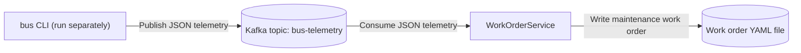

# DirectToTopic.SingleConsumer – bus telemetry to work order

This demo simulates a bus returning to a maintenance bay where it sends telemetry to indicate that it has a fault. In this example, the bus sends the message directly to a Kafka topic. In the [HttpProxy.SingleConsumer demo](../HttpProxy.SingleConsumer/README.md), a REST message is posted to an HTTP endpoint.

An Aspire AppHost starts a Kafka container (with Kafka UI) and a C# worker service. The worker reads bus telemetry
from the `bus-telemetry` topic and writes a maintenance work order as a commented YAML file to `DirectToTopic.SingleConsumer/work-orders/`.
The `bus` CLI publishes one random telemetry message per invocation. You run it separately; Aspire does not start it.



## Run

Requires the .NET 11 SDK and a container runtime (Docker/Podman).

Run these commands from the repository root. First start Kafka and the worker:

```sh
dotnet run --project DirectToTopic.SingleConsumer/AppHost
```

Once the worker is listening, run the CLI in another terminal:

```sh
dotnet run --project DirectToTopic.SingleConsumer/Bus
```

The CLI sends JSON directly to `bus-telemetry` on `localhost:9092`, keyed by bus ID. On success it prints
the delivered topic, partition, offset, and JSON payload. A file named `Alert-<alertId without hyphens>.yaml`
appears in `DirectToTopic.SingleConsumer/work-orders/`. You can also view the message in Kafka UI from the Aspire dashboard.

### CLI options

Both options are optional. Without them, the CLI chooses a random bus ID (`B-1` through `B-99`) and a new alert GUID.

```sh
dotnet run --project DirectToTopic.SingleConsumer/Bus -- --id B-42 --alertid 6ba7b810-9dad-11d1-80b4-00c04fd430c8
dotnet run --project DirectToTopic.SingleConsumer/Bus -- --help
```

`--id` sets `busId` and must not be blank. `--alertid` sets the contract's `alertId` and must be a GUID;
it is not a WorkOrderId. Reuse an alert ID to test duplicate-alert handling: the worker keeps the first work order
and ignores subsequent messages with that ID. Each CLI invocation generates new readings, even when the IDs are reused.
A real producer should retry the original reading with the same alert ID.

The reading uses the current UTC timestamp, an odometer value from 10,000 up to 400,000 km,
an engine temperature from 80 up to 120 degrees Celsius, and brake pad thickness from 2 up to 12 mm
(upper bounds excluded, readings in tenths). About 30% of messages include one or two distinct fault codes.
Readings can produce Routine, High, or Urgent work orders.

Invalid arguments and Kafka delivery failures return a nonzero exit code. If Kafka is unavailable,
delivery times out after about ten seconds; start the AppHost before running the CLI.

### Publish bus.exe for Windows

Create a self-contained Windows x64 build from the repository root:

```sh
dotnet publish DirectToTopic.SingleConsumer/Bus -c Release -r win-x64 --self-contained true -o artifacts/DirectToTopic.SingleConsumer/bus/win-x64
```

Keep all files in the output directory together. The build includes `bus.exe`, the .NET runtime,
and the native Kafka client libraries, so it does not need a separately installed .NET runtime.
On the Windows machine running this demo's AppHost, invoke it from PowerShell:

```powershell
.\artifacts\DirectToTopic.SingleConsumer\bus\win-x64\bus.exe --id B-42 --alertid 6ba7b810-9dad-11d1-80b4-00c04fd430c8
```

On Linux or macOS, use `dotnet run` as shown above or publish for the appropriate runtime identifier;
the executable is named `bus` on those platforms.

## Kafka container
Both demos use the same persistent container, `ctpdemos-kafka`, with host ports `9092` (clients) and `9093` (internal listener).
Keep the Kafka name, image, ports, and environment settings identical in both AppHosts so switching demos reuses the running broker
instead of recreating it. These ports must be free on the first run. Stop one AppHost before starting the other; Kafka stays running.

The bus CLI, the worker's consumer, and the worker's topic-admin client force Kafka connections to use IPv4. On some machines,
`localhost` resolves to IPv6 (`::1`) first, but the host-facing Kafka endpoint in this setup is reached over IPv4. If a client
chooses the IPv6 address, it may fail to connect; selecting IPv4 avoids that address-family mismatch.

The demos share the `bus-telemetry` topic and `work-order-service` consumer group, including committed offsets.
Switching demos continues from those offsets rather than replaying previously consumed records. Use a new alert ID for a new reading.
Running both workers together makes them compete for messages, not each receive a copy.

This preserves the container, not its data independently of that container; removing or recreating it may lose its topics and messages.
Older automatically named Kafka containers are not adopted or migrated; remove those separately with `docker rm -f <container-name>`
(or `podman rm -f <container-name>`) if no longer needed.

When you no longer need the shared broker, stop the AppHosts and remove it manually:

    docker rm -f ctpdemos-kafka

## Message contract
The telemetry contract is documented in [asyncapi.yaml](asyncapi.yaml) (AsyncAPI 3.0): topic `bus-telemetry`,
JSON payload. A sample message, also included in that document:

    {"alertId":"6ba7b810-9dad-11d1-80b4-00c04fd430c8","busId":"B-42","timestamp":"2026-01-15T08:30:00Z","odometerKm":182340.5,"engineTempC":115,"brakePadThicknessMm":3.2,"faultCodes":["P0217"]}

The producer-side model is `Bus/Messages/BusTelemetry.cs` and the consumer-side model is
`WorkOrderService/Messages/BusTelemetry.cs`; keep both in sync with the document.
