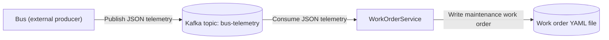

# DirectToTopic.SingleConsumer – bus telemetry to work order

This demo simulates a bus returning to a maintenance bay where it sends telemetry to indicate that it has a fault. In this example, the bus sends the message directly to a Kafka topic. In the [HttpProxy.SingleConsumer demo](../HttpProxy.SingleConsumer/README.md), a REST message is posted to an HTTP endpoint.

An Aspire AppHost starts a Kafka container (with Kafka UI) and a C# worker service. The worker reads bus telemetry
from the `bus-telemetry` topic and writes a maintenance work order as a commented YAML file to `DirectToTopic.SingleConsumer/work-orders/`.

## Run
Requires the .NET 11 SDK and a container runtime (Docker/Podman).

    dotnet run --project DirectToTopic.SingleConsumer/AppHost

Open the Aspire dashboard, then open Kafka UI and produce a message to `bus-telemetry` (see the contract below). The producer sends the internal alert's stable `alertId` GUID, not a WorkOrderId; reuse the same alert ID on retries so the service creates at most one work order for that alert.

A file such as `DirectToTopic.SingleConsumer/work-orders/Alert-6ba7b8109dad11d180b400c04fd430c8.yaml` appears. The telemetry producer is outside this demo's scope.

## Kafka container
Both demos use the same persistent container, `ctpdemos-kafka`, with host ports `9092` (clients) and `9093` (internal listener).
Keep the Kafka name, image, ports, and environment settings identical in both AppHosts so switching demos reuses the running broker
instead of recreating it. These ports must be free on the first run. Stop one AppHost before starting the other; Kafka stays running.

The demos share the `bus-telemetry` topic and `work-order-service` consumer group, including committed offsets.
Switching demos continues from those offsets rather than replaying previously consumed records. Use a new alert ID for a new reading.
Running both workers together makes them compete for messages, not each receive a copy.

This preserves the container, not its data independently of that container; removing or recreating it may lose its topics and messages.
Older automatically named Kafka containers are not adopted or migrated; remove those separately with `docker rm -f <container-name>`
(or `podman rm -f <container-name>`) if no longer needed.

When you no longer need the shared broker, stop the AppHosts and remove it manually:

    docker rm -f ctpdemos-kafka

## Message contract
The telemetry contract is documented in [asyncapi.yaml](asyncapi.yaml) (AsyncAPI 3.0): topic `bus-telemetry`,
JSON payload. A sample message, also included in that document:

    {"alertId":"6ba7b810-9dad-11d1-80b4-00c04fd430c8","busId":"B-42","timestamp":"2026-01-15T08:30:00Z","odometerKm":182340.5,"engineTempC":115,"brakePadThicknessMm":3.2,"faultCodes":["P0217"]}

The consumer-side model is `WorkOrderService/BusTelemetry.cs`; keep it in sync with the document.
