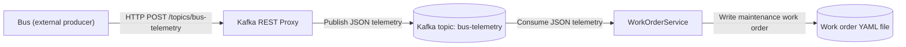

# HttpProxy.SingleConsumer – bus telemetry through a REST proxy to work order

This demo simulates a bus returning to a maintenance bay where it sends telemetry to indicate that it has a fault. In this example, a REST message is posted to an HTTP endpoint.

This demo is identical to the [DirectToTopic.SingleConsumer](../DirectToTopic.SingleConsumer/README.md) demo with the one change being to how the message is delivered. It models an external producer whose delivery mechanism we do not control. The producer remains outside the demo; the HTTP commands below stand in for the bus.

An Aspire AppHost starts Kafka (with Kafka UI), Kafka REST Proxy, and a C# worker service. The worker is unchanged:
it reads JSON telemetry from the `bus-telemetry` topic and writes a maintenance work order as a commented YAML file to
`HttpProxy.SingleConsumer/work-orders/`. No HTTP consumer or custom forwarding service is needed.



## Run
Requires the .NET 11 SDK and a container runtime (Docker/Podman).

    dotnet run --project HttpProxy.SingleConsumer/AppHost

Open the Aspire dashboard. Wait for `kafka-rest` to be healthy and for `work-order-service` to log
`Listening for bus telemetry on topic bus-telemetry`; the worker creates the topic at startup.
Copy the `kafka-rest` HTTP endpoint from the dashboard (Aspire assigns the host port), then publish a reading:

```sh
export KAFKA_REST_URL="http://localhost:<port-from-dashboard>"
curl --fail-with-body --request POST "$KAFKA_REST_URL/topics/bus-telemetry" \
  --header 'Content-Type: application/vnd.kafka.json.v2+json' \
  --header 'Accept: application/vnd.kafka.v2+json' \
  --data '{"records":[{"value":{"alertId":"6ba7b810-9dad-11d1-80b4-00c04fd430c8","busId":"B-42","timestamp":"2026-01-15T08:30:00Z","odometerKm":182340.5,"engineTempC":115,"brakePadThicknessMm":3.2,"faultCodes":["P0217"]}}]}'
```

Or use PowerShell:

```powershell
$kafkaRestUrl = "http://localhost:<port-from-dashboard>"
$request = @{
    Uri = "$kafkaRestUrl/topics/bus-telemetry"
    Method = 'Post'
    ContentType = 'application/vnd.kafka.json.v2+json'
    Headers = @{ Accept = 'application/vnd.kafka.v2+json' }
    Body = '{"records":[{"value":{"alertId":"6ba7b810-9dad-11d1-80b4-00c04fd430c8","busId":"B-42","timestamp":"2026-01-15T08:30:00Z","odometerKm":182340.5,"engineTempC":115,"brakePadThicknessMm":3.2,"faultCodes":["P0217"]}}]}'
}
$response = Invoke-RestMethod @request
$response.offsets | Format-Table partition, offset, error_code, error
```

The REST Proxy v2 JSON API requires the `records`/`value` envelope and media types shown above.
Only the object inside `value` is written to Kafka, so the existing consumer receives the same JSON as in the direct-to-topic demo.
A successful response contains an `offsets` entry with `error_code` and `error` both `null`; check these fields even if HTTP returns 200.
Kafka UI can be used to inspect the resulting record, but use HTTP rather than Kafka UI to produce messages in this demo.

A file such as `HttpProxy.SingleConsumer/work-orders/Alert-6ba7b8109dad11d180b400c04fd430c8.yaml` appears.
The producer sends the internal alert's stable `alertId` GUID, not a WorkOrderId; reuse the same alert ID on retries so the
service creates at most one work order for that alert. Repeating the request should not create another file.

## Kafka container
Both demos use the same persistent container, `ctpdemos-kafka`, with host ports `9092` (clients) and `9093` (internal listener).
Keep the Kafka name, image, ports, and environment settings identical in both AppHosts so switching demos reuses the running broker
instead of recreating it. These ports must be free on the first run. Stop one AppHost before starting the other; Kafka stays running.

The demos share the `bus-telemetry` topic and `work-order-service` consumer group, including committed offsets.
Switching demos continues from those offsets rather than replaying previously consumed records. Use a new alert ID for a new reading.
Running both workers together makes them compete for messages, not each receive a copy.

This preserves the container, not its data independently of that container; removing or recreating it may lose its topics and messages.
Older automatically named Kafka containers are not adopted or migrated; remove those separately with `docker rm -f <container-name>`
(or `podman rm -f <container-name>`) if no longer needed.

When you no longer need the shared broker, stop the AppHosts and remove it manually:

    docker rm -f ctpdemos-kafka

The REST Proxy container stops with the AppHost. Its HTTP endpoint is for local demonstration only; do not expose this
unauthenticated, plaintext setup publicly.

## Message contract
The telemetry contract is documented in [asyncapi.yaml](asyncapi.yaml) (AsyncAPI 3.0): topic `bus-telemetry`,
JSON payload. A sample message, also included in that document:

    {"alertId":"6ba7b810-9dad-11d1-80b4-00c04fd430c8","busId":"B-42","timestamp":"2026-01-15T08:30:00Z","odometerKm":182340.5,"engineTempC":115,"brakePadThicknessMm":3.2,"faultCodes":["P0217"]}

The consumer-side model is `WorkOrderService/Messages/BusTelemetry.cs`; keep it in sync with the document.
The contract describes the Kafka record payload, not the HTTP envelope used to deliver it.
