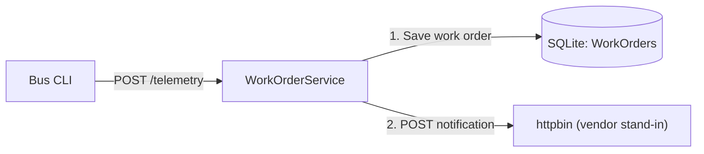

# RestEndpoint.DualWrite - bus telemetry to SQLite and a vendor notification

A bus posts telemetry to a small REST service. The service turns it into a work order,
saves it in a real SQLite database, then POSTs a different JSON message to
[httpbin](https://httpbin.org/post), standing in for a vendor system.
Aspire starts the service. Run the `bus` CLI separately.



## What this demonstrates

The two writes are deliberately **not atomic**. There is no outbox, distributed transaction,
automatic retry, or deduplication.

* If SQLite fails, no vendor POST is attempted.
* If the vendor rejects the POST, cannot be reached, or times out, the saved work order remains.
  The service returns HTTP 502 Problem Details with its `workOrderId`; it does not roll back SQLite.
* A crash or lost response can leave the caller unsure which writes completed.
  Error messages describe an unknown, possibly inconsistent state rather than assume the write order.
  Verify the database and vendor system before retrying.
* Every accepted telemetry request creates a new work order, even when `alertId` is repeated.
  Retrying after a partial failure can create another work order and another notification.

The two calls sit next to each other in
[`DualWriteService.CreateAsync`](WorkOrderService/Services/DualWriteService.cs):
`SaveWorkOrderAsync` followed by `NotifyVendorAsync`. Reverse those calls to demonstrate the other failure
window: the vendor can be notified before the database write fails. The response and logs do not
claim that the two writes succeeded together.

Both calls are awaited. The store interface supports asynchronous database implementations;
the SQLite implementation writes synchronously and returns a completed task because
Microsoft.Data.Sqlite does not support asynchronous I/O.

> This is a local demonstration, not a production reliability pattern. httpbin is a public,
> third-party echo service: send synthetic telemetry only, not credentials or real fleet data.
> Its availability, rate limits, and network access can affect the demo.

## Run

Requires the .NET 11 SDK and outbound HTTPS access to httpbin.
This demo does not need Kafka or a database container; SQLite runs inside the service process.
Commands below run from the repository root.

```powershell
dotnet run --project .\RestEndpoint.DualWrite\AppHost
```

Open the dashboard URL printed by Aspire and wait for `work-order-service` to become healthy.
Copy its HTTP endpoint. In another terminal, append `/telemetry` and run:

```powershell
dotnet run --project .\RestEndpoint.DualWrite\Bus -- --url http://localhost:<port-from-dashboard>/telemetry
```

Keep the AppHost terminal running during the demo. Press Ctrl+C in that terminal to stop it.

The CLI prints each reported operation's outcome, for example:

```text
Succeeded: Save work order
Succeeded: Notify vendor
Request completed: HTTP 201 Created
```

If an operation fails, its line starts with `Failed:` and the CLI exits nonzero. An operation
that was not attempted has no line. The CLI lists operations in execution order and can include
additional operations; the CLI does not infer outcomes from the HTTP status.
If the response is lost, the CLI reports the request failure without inventing operation results.

The response's `Location` header points to `GET /work-orders/{workOrderId}`.
The worker's **Console logs** show `Saved work order ... to SQLite`, followed by
`Vendor accepted notification ...` or an explicit failure.
Console logging is configured; OpenTelemetry export is not.

You can also run the service without Aspire:

```powershell
dotnet run --project .\RestEndpoint.DualWrite\WorkOrderService
dotnet run --project .\RestEndpoint.DualWrite\Bus
```

The standalone service and CLI default to `http://localhost:5080`.
Do not run the standalone service and its Aspire-managed instance on the same port together.
The service is unauthenticated and uses local plaintext HTTP; do not expose it publicly.

### CLI options and bus.exe

The CLI uses the same base telemetry fields, random reading generator, `--id`, and `--alertid`
options as [DirectToTopic.SingleConsumer](../DirectToTopic.SingleConsumer/README.md).
`--url` is the full telemetry endpoint URL; it defaults to `http://localhost:5080/telemetry`.
Both HTTP and HTTPS are supported. Blank bus IDs and invalid arguments are rejected.
`--vendorError` adds `"vendorError": true` to the telemetry message so the service sends that
request's vendor notification to [httpbin's HTTP 503 endpoint](https://httpbin.org/status/503).
Without the flag, the field is omitted and the configured vendor URL is used as before.

`--dbUpdateError` adds `"dbUpdateError": true` and throws a database-agnostic
`DataStoreUpdateException` at the datastore write. The error response is titled `Data store update failed`.
With the current write order, the service returns HTTP 500, no row is inserted, and the vendor
call is not attempted. The CLI reports only `Failed: Save work order`.

`--dbCommitError` adds `"dbCommitError": true`. It is ignored when there is no explicit
transaction, as in this demo's current SQLite implementation. SQLite's implicit autocommit
does not count as an explicit commit operation, so the flag does not cause a failure or
produce a commit report. No transaction is introduced by either flag.
All three error flags default to `false` and are omitted from CLI telemetry when unset.

```powershell
dotnet run --project .\RestEndpoint.DualWrite\Bus -- --id B-42 --url http://localhost:5080/telemetry
dotnet run --project .\RestEndpoint.DualWrite\Bus -- --help
dotnet run --project .\RestEndpoint.DualWrite\Bus -- --vendorError --url http://localhost:5080/telemetry
dotnet run --project .\RestEndpoint.DualWrite\Bus -- --dbUpdateError --url http://localhost:5080/telemetry
dotnet run --project .\RestEndpoint.DualWrite\Bus -- --dbCommitError --url http://localhost:5080/telemetry
```

To demonstrate duplicate alerts, run twice with the same `--alertid` GUID.
Unlike the Kafka demos, both invocations create work orders. The random readings change with
each invocation; resend the same JSON with the request file below to repeat an identical reading.

Publish a self-contained Windows x64 CLI:

```powershell
dotnet publish .\RestEndpoint.DualWrite\Bus -c Release -r win-x64 --self-contained true -o .\artifacts\RestEndpoint.DualWrite\bus\win-x64
.\artifacts\RestEndpoint.DualWrite\bus\win-x64\bus.exe --id B-42 --url http://localhost:5080/telemetry
```

Keep all published files together. No separately installed .NET runtime is required.
HTTP errors, connection failures, and timeouts return a nonzero exit code.
The vendor request times out after ten seconds; the CLI request after thirty.
Neither HTTP client retries automatically or follows redirects.

## Database

The SQLite store also implements `IWorkOrderStore.BeginUpdateMessage` and `Commit`.
`BeginUpdateMessage` starts a transaction and stages the insert without committing it.
Use `using` for the returned `Transaction`: disposal rolls back uncommitted changes and releases
the connection. `Commit` persists the insert and releases the transaction and connection.
Committing a completed or disposed handle, or using it with another store instance, is rejected.
The handle is database-agnostic and uses reference identity rather than record equality.

`dbUpdateError` fails the staged insert. `dbCommitError` throws a database-agnostic
`DataStoreCommitException` when `Commit` is attempted; the pending insert is rolled back.
The existing HTTP processing flow still calls `SaveWorkOrderAsync`, so it remains
nontransactional and continues to ignore `dbCommitError`. These methods do not make HTTP vendor
notifications part of the database transaction.

The service creates `data/work-orders.db` and its `WorkOrders` table on startup, without seed rows.
The database and SQLite sidecar files are ignored by Git. Data survives service and AppHost restarts.
Each insert is one atomic SQLite statement, not a transaction covering the vendor call.

The table contains `WorkOrderId` (primary key), `AlertId` (not unique), `BusId`, `CreatedAt`,
`Priority`, `Tasks` (JSON), and `SourceTelemetry` (JSON).
The full work order has the same fields and transformation rules as the existing demos:
hot engines or thin brake pads produce Urgent work orders; fault codes otherwise produce High
priority; no findings produce a Routine scheduled inspection.

Open the file with a SQLite viewer, or use a separately installed SQLite CLI:

```powershell
sqlite3 .\RestEndpoint.DualWrite\data\work-orders.db "SELECT WorkOrderId, AlertId, BusId, Priority FROM WorkOrders;"
```

`WorkOrders__DatabasePath` overrides the file path. Relative paths resolve against the service's
content root; Aspire passes an absolute path so the default file location stays consistent.
To reset the demo, stop the service before deleting the database and its sidecar files.

## HTTP contract

[`WorkOrderService.http`](WorkOrderService/WorkOrderService.http) contains a complete telemetry
request and examples for every endpoint. Change its `baseUrl` to the Aspire endpoint.
The generated OpenAPI contract is available at `/openapi/v1.json`.

* `POST /telemetry` accepts the same JSON telemetry fields as the existing demos:
  `alertId`, `busId`, `timestamp`, `odometerKm`, `engineTempC`, `brakePadThicknessMm`,
  and optional `faultCodes`. There is no Kafka REST Proxy envelope.
  This demo also accepts optional `vendorError`, `dbUpdateError`, and `dbCommitError` booleans
  (default `false`) for failure demonstrations. `dbCommitError` is ignored without an explicit transaction.
  Missing required fields, malformed JSON/GUIDs, or a blank `busId` return HTTP 400 before either write.
* HTTP 201 returns `workOrder` (containing `workOrderId`, `busId`, `createdAt`, `priority`,
  `tasks`, and `sourceTelemetry`) and an `operations` array.
  Each entry has an `operation` name and a `succeeded` boolean. Only attempted operations appear.
* `GET /work-orders/{workOrderId}` reads the saved row, including after a failed vendor call.
  Unknown IDs return HTTP 404.
* Vendor failures return HTTP 502; database and unexpected server failures return HTTP 500.
  Error responses use Problem Details. A client disconnect may prevent delivery of the response
  even though a write has already completed.
  Processing failures include the observed `operations` and `workOrderId` as Problem Details
  extensions, including any successes before the failure. A failed operation does not prove that
  the remote system made no changes; verify system state before retrying.
* `GET /health` reports local HTTP readiness, not vendor availability or atomic delivery.

The vendor receives `workOrderId`, `alertId`, `busId`, `createdAt`, `priority`, and `tasks`.
It does **not** receive `sourceTelemetry` or the original readings. Both outputs refer to the
same newly generated work order. A successful response from httpbin demonstrates HTTP acceptance,
not actual processing by a vendor.

`Vendor__NotificationUrl` overrides the complete vendor URL (default:
[https://httpbin.org/post](https://httpbin.org/post)). To demonstrate partial failure without
restarting the service, run the Bus CLI with `--vendorError`. The vendor returns HTTP 503,
the service returns HTTP 502, and the SQLite work order remains saved. The next request without
the flag uses the configured vendor URL again. The flag is stored in `sourceTelemetry` but is
not included in the vendor notification.

To override the vendor URL for all normal requests instead, press Ctrl+C
in the AppHost terminal, then restart it in that terminal with a failing endpoint:

```powershell
$env:Vendor__NotificationUrl = "https://httpbin.org/status/500"
dotnet run --project .\RestEndpoint.DualWrite\AppHost
```

Send telemetry and inspect the saved row even though the CLI reports HTTP 502.
Press Ctrl+C again, then remove the environment override in the same terminal and restart the
AppHost to restore the successful endpoint:

```powershell
Remove-Item Env:\Vendor__NotificationUrl
dotnet run --project .\RestEndpoint.DualWrite\AppHost
```

## Shared code and tests

The projects link the existing
[generator](../DirectToTopic.SingleConsumer/Bus/Services/TelemetryGenerator.cs),
[work-order model](../DirectToTopic.SingleConsumer/WorkOrderService/Messages/WorkOrder.cs), and
[factory](../DirectToTopic.SingleConsumer/WorkOrderService/Services/WorkOrderFactory.cs).
Linked sources avoid another copy of the generation and work-order rules without changing
the other demos. This demo has its own [producer telemetry model](Bus/Messages/BusTelemetry.cs)
and [consumer telemetry model](WorkOrderService/Messages/BusTelemetry.cs) to add the error switches
without changing the Kafka contracts. Keep their base fields consistent with the existing demos.

```powershell
dotnet build .\RestEndpoint.DualWrite.slnx
dotnet test .\RestEndpoint.DualWrite\WorkOrderService.Tests\WorkOrderService.Tests.csproj
```

The integration tests use temporary, file-backed SQLite databases and an in-process vendor
HTTP handler. They do not call httpbin. They cover write order, payload differences, persistence,
duplicates, validation, database failure, and vendor rejection, redirects, connection failures,
and timeouts.
